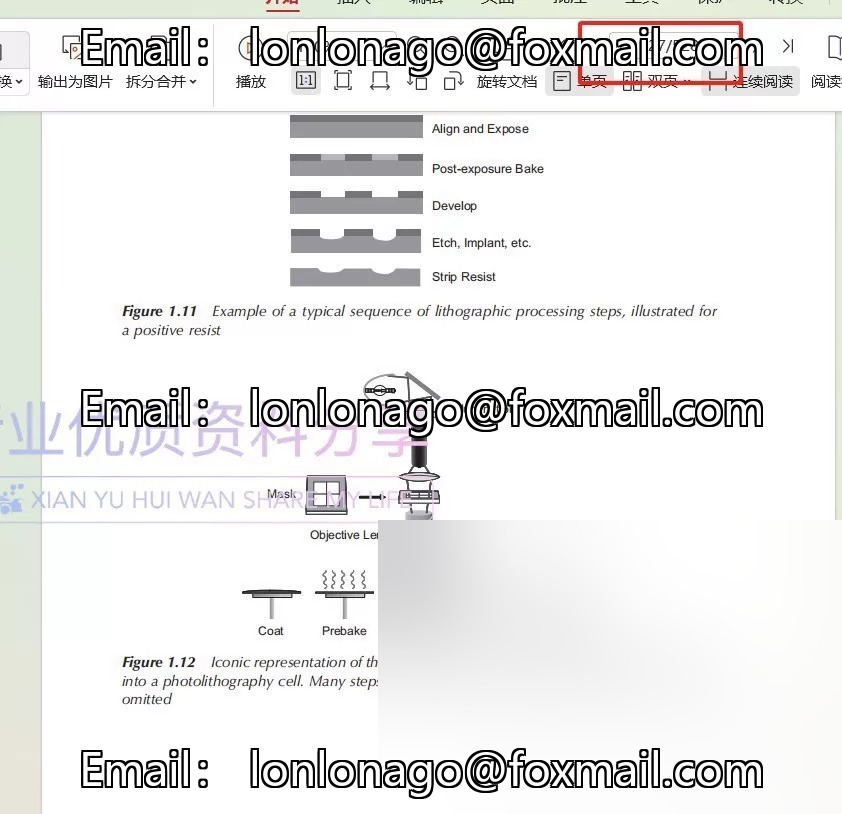
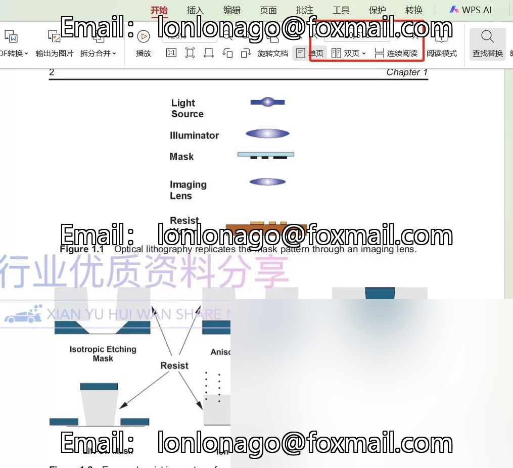
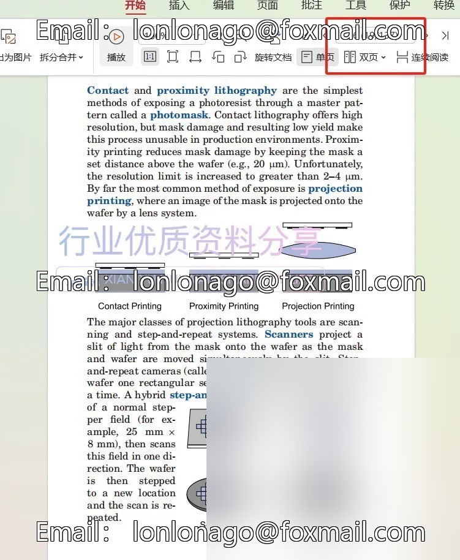

# #pdf lithography optical data set, including three documents totaling over 1,000 pages, with content extremely extensive.

## Body

#PDF optical lithography materials set, including three files, totaling over 1000 pages, with extremely precious content. It covers the basic principles of optical lithography, micro processing science, and other aspects, suitable for researchers and students to use. Very detailed and practical.

Take a photo and immediately send the electronic original file! The following images are screenshots of the file directory. Confirm before placing the order! Due to the replicability of electronic filing materials, So after purchase, returns are not allowed! Thanks for understanding!

The set consists of three files totaling more than a thousand pages, covering principles of optical lithography and microprocessing science and is suitable for researchers and students; the images show a file directory screenshot, and the materials are copyable with no returns after purchase.

<!-- AI_ENRICHED -->

## Images

## Payment

Here is a pay link on Stripe ( https://buy.stripe.com/3cs8yP7sY87d0vu9AB ). Please contact me lonlonago@foxmail.com after funding $89, and I will send you a complete data files , thank you!

